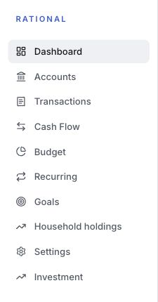
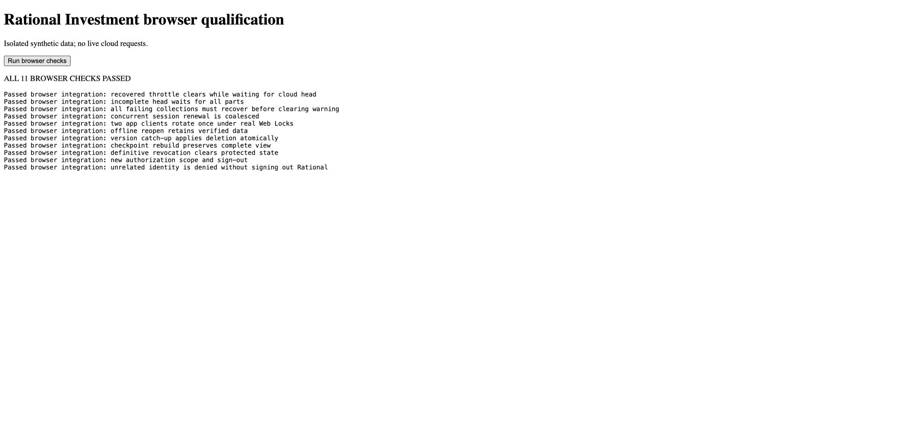

# Rational Investment integration validation

October 14 final data verification passed for all 14 non-head collections. The
cloud-computed destination saved-input export has the same complete SHA-256,
82,524 records and 6,615,522,833 bytes as the sealed source. The other 13
collections match exactly. This complete export proof supersedes the partial
scheduled row scan, without claiming that scan completed. The verified source's
graph/history/captures and all nine native/Wasm report comparisons remain pinned.

The final portfolio head is published and its exact readback passed. Six source
writer functions remain closed, no source write credential is active, and
household function versions/configurations and schedules are unchanged.
Destination API/jobs versions 3/3 are active after the hosted browser rendered
the verified portfolio. Exactly one Investment dispatcher is enabled; two
scheduled runs succeeded and imported job checkpoints advanced without local
workers. All 784 imported job identities were preserved.

The temporary serverless verifier passed 51 hosted function tests, including
interrupted checkpoint recovery, overlapping invocations, transient failures,
per-request audit identities, mismatch detection and bounded page resumption.
All three OpenSpec changes pass strict validation. The frontend suite now has 14 passing tests, including queued-backlog recovery
and bounded, fair polling. Lint passes. Clean GitHub production builds and Pages
deployment passed after including the provenance-matching browser Wasm package.
No local migration worker or bulk download is running.

Hosted checks passed for separate app navigation, shared owner sign-in, version
249, 11 visible accounts, populated transactions/positions/performance, and a
performance deep-link reload. Two earlier unexpected sign-outs remain a session
stability follow-up; the latest Google session passed repeated app transitions.
No sign-out fix is claimed without a confirmed cause.

Concurrent migration commands exposed a separate CLI refresh-cookie race. Mako
Cloud PR #20 coordinates renewal and logout across processes, preserves concurrent
profile updates, and rejects a changed endpoint in a long-lived client. All eight
CI checks passed; the merged CLI is installed, and interrupted migration commands
resumed their existing jobs and receipts without another sign-in. This required
no cloud service redeployment.

## Completed checks

- Combined static production build, Rational type checks and Investment lint.
- 230 Rational unit tests, 51 hosted Investment function tests, 14 Investment
  frontend tests, 19 migration-tool tests and 78 Rust workspace tests.
- Nine local integration checks using the actual auth/RxDB/Dexie code.
- Eleven isolated real-Chrome checks, including concurrent token refresh under Web
  Locks, offline reopen, incomplete graph handling, authorization reset, logout,
  and denial of unrelated users without signing them out of Rational.
- Live Google sign-in, shared authentication across both entry points, cross-tab
  sign-out/sign-in, household navigation, and household offline/online controls.
- Production `/rational/investment/` assets, hash navigation and deep-link refresh.
- Complete rehearsal source graph/history and native/Wasm financial-report parity;
  exact destination parity for the staged portfolio graph, command history,
  cache status and saved input records.
- Public source/build scan against known private credentials and token signatures;
  strict validation of all three retained OpenSpec changes.
- Mako Cloud exporter retirement verified on upstream main; its only workflow is
  CI, with no repository webhooks or deploy keys present at audit time.

Protected source data, exports and operational receipts remain under `.local/`.
The screenshots below contain navigation or synthetic data only.

## Remaining checks

### October 13 cutover preparation

All 15 destination staging collections exported successfully. All 14 non-head
collections match the rehearsal source exactly; the destination head remains
absent. A local verification-only composite of staged records and the rehearsal
head passed graph/history/artifact validation and all nine native/Wasm financial
report comparisons. This composite is never a cloud import source.

Twenty-one focused admission, draining, replay, and migration tests passed, and
both production builds passed. Source API/jobs versions 7/9 enforce draining;
owner-authenticated status reads return 200 and a new-command probe returns 503.
All four retained legacy functions return 503 with no attached secrets, and the
old native worker identity is disabled. Checkpoint drain is in progress, so the
final source snapshot and destination activation remain pending.

The local combined build's live Google sign-in succeeded. Following Investment
opened its separate page with the same signed-in owner and a Back to Rational
link. Portfolio rendering awaits publication of the verified final head.

### October 12 authenticated resumption

The installed CLI login now retains a refresh cookie (`renewable: true`), and
credential inventory succeeds in both environments. All 142 metadata reads pass;
source and destination metadata match the earlier verified inventory. The complete
source writer inventory identifies 14 active write-capable service credentials.
OpenSpec task 4.1 is complete; overall progress is 21/31.

A fresh complete destination Investment snapshot passes export integrity checks,
including all 2,017 large saved-input records. A resumable import of the remaining
36,616 rehearsal price records was admitted using the fresh baseline. Subsequent
job-status calls and a separate household export were interrupted when Caddy began
returning empty HTTP 403 responses for both the homepage and management routes.
Operator investigation then verified the durable job state directly through the
VM: all 36,616 price records committed with zero failures, and the household export
succeeded with 15 records. No replacement import was submitted. After recovery,
the original receipt was journaled and a fresh destination export verified exact
logical parity for all 38,184 rehearsal price records. All 13 household collections
also exported successfully into the protected baseline.

The preview guard closed admission because control-plane audit readiness latched
false. Storage was healthy with one recorded busy timeout; the exact failing audit
operation was not logged. Restarting only the control plane restored all four
private readiness endpoints. [Mako Cloud PR #17](https://github.com/makodb/mako-cloud/pull/17)
adds bounded audit retries and diagnostics. It passed all eight CI checks, was merged
and deployed, and public admission was restored with the approved preview renewal.
The running binaries match release `696d3644`; all four services are ready, with
configuration and retained backup state unchanged. Authenticated credential
inventory succeeds in both environments. The installed CLI renewed an expired
session automatically, without another sign-in. Remaining staging imports resumed.
Source fencing, destination activation, and
Pages publication have not occurred. Incident evidence is protected under
`.local/integration/platform-incident-20261012/`.

Evidence and journals: `.local/integration/deployment-recheck-20261012/`,
`staging-baseline-20261012/`, `staging-import-20261012/`, and
`household-before-cutover-20261012/`. The protected checkpoint records exact job IDs.

### October 12 deployment recheck

The credential-list routes now reach authentication: unauthenticated probes return
structured HTTP 401 responses in both environments instead of empty HTTP 404s.
Upstream records release `e32a5ca3` from `7bc9fc0`; its code includes the 30-second
bulk RPC budget. Authenticated credential listing and import resumption remain
unverified because the local developer session expired.

Investigation found the CLI expected `__Host-mako_developer_refresh`, while the
server sends `__Secure-mako_developer_refresh`. The local CLI is corrected and
[PR #16](https://github.com/makodb/mako-cloud/pull/16) contains the fix. Matching the
test fixture to production reproduces two failures before the fix; all 14 auth
foundation tests pass afterward. The full CLI suite passes 138/140 tests; two
local-serve tests require Docker or Podman, neither available here. A fresh private
login is required to capture a refresh cookie. No application-data migration writes
were attempted. Route evidence is protected under
`.local/integration/deployment-recheck-20261012/`.

### October 11 resume verification

GitHub access and writes to the Rational checkout work again. Both follow-up PRs
below merged on October 4, but merge alone does not verify deployment. An
unauthenticated probe of the credential inventory route still returns HTTP 404
with an empty body, while `/v1/projects` returns a structured JSON response.
Following renewed private sign-in, authenticated credential inventory returns the
same 404 in both environments. Direct SSH to the documented platform deployment
host times out. No application-data migration mutations were attempted.

Authenticated reads confirm unchanged function versions/configurations, an enabled
source dispatcher, a paused destination dispatcher, no destination portfolio head,
and enabled household schedules. All 140 other metadata reads succeeded. Household
schemas/rules/indexes are unchanged; policy envelopes only differ in the environment
authorization epoch (118 to 133 after additive Investment provisioning). All 15
Investment schemas, mapped owner policies, and indexes match. Both mapped owner
identities are active. A fresh destination price export verifies all 1,568 records
exactly against both the rehearsal source and prior partial baseline. Source jobs
include 305 queued and two retrying records; cutover still requires reconciliation.
Protected evidence is under `.local/integration/resume-live/` and
`.local/integration/resume-price-baseline/`.

Re-ran successfully: both production builds, Rational type checks, Investment
lint, 224 Rational unit tests, 40 hosted function tests, 12 Investment frontend
tests, 13 migration-tool tests, 78 Rust workspace tests, seven local integration
checks, and all nine isolated real-Chrome checks. Strict OpenSpec validation passes
all three changes. A scan of 566 tracked/build files found no matches for known
private credentials or private-key headers. Protected logs use the
`.local/integration/resume-*` prefix. These checks do not substitute for live
destination parity or cutover validation.

Mako Cloud [PR #4](https://github.com/makodb/mako-cloud/pull/4) and
[PR #11](https://github.com/makodb/mako-cloud/pull/11) are merged and deployed.
The large-document export now succeeds. The import still fails after partial
commits, with the new `worker_internal_transport` diagnostic. A fresh destination
export confirms exact source contents for every imported price record.
[PR #12](https://github.com/makodb/mako-cloud/pull/12) repairs the Caddy route
that blocks credential inventory.
[PR #13](https://github.com/makodb/mako-cloud/pull/13) adds a separate bulk RPC
timeout budget and timeout-specific diagnostics. Its delayed-response regression
fails with the old budget and passes with the fix; 276 related Rust tests and
scoped Clippy pass. Both follow-ups are merged; credential-route deployment remains
blocked by the observed 404, and bulk-timeout deployment remains unverified.

Full staged data/report parity, live Investment accounts/trades/options, import
and provider flows, and admin actions remain pending. The latest source service-key
inventory route also needs the Caddy configuration fix. No live source admission fence, final snapshot,
destination activation or Pages publication has occurred. Follow
[the migration runbook](investment-migration.md) before taking those steps.

### October 13 synchronization warning

Cloud telemetry confirmed that the initial preview synchronization reached the
platform replication throttle (120 requests/minute), with five retryable failures
in the 05:07 UTC minute. Requests recovered in the following minute; subsequent
usage settled at 10 requests/minute. The warning persisted because successful
empty pulls did not update the application status. Recovery now clears the warning
only after every failing collection succeeds, including when no head exists or
the current generation is unchanged. Nine local integration checks and eleven
real Chrome fixture checks passed, along with frontend lint and production build.
The live preview correctly displays “Waiting for the cloud portfolio” until final
head publication. That UI fix did not change platform quotas.

Mako Cloud PR #18 removes the 120-per-minute replication request cap from the
gateway default and generated plan policies. The deployed release was verified
against the committed source and running binary hashes; all services passed
readiness, with configuration and existing storage preserved. An authenticated
read-only probe changed from 120 successful requests plus 40 HTTP 429 responses
to 160 successful requests in one minute with no throttling. The preview reloaded
without the rate-limit warning. Daily request allowances and byte-volume limits
remain; this change does not remove the separate bulk-export artifact limit.

### October 13 final source fence

All active jobs completed, leaving 335 accepted queued jobs, 447 completed jobs,
and two cancelled jobs. Bounded source cleanup finished its source-bound cursor.
The dispatcher is paused; source API/jobs versions 8/10 and four retained writer
functions now have no attached credentials or allowed outbound hosts. All six
closed-handler probes returned 503. Fourteen source write-capable service keys
were retired, while destination credentials were untouched. After a full claim
lease, another complete job inventory verified no active checkpoint, running
worker, uncertain job, or cleanup cursor. Final snapshot verification now also
rejects terminal cleanup cursors and needs-attention jobs explicitly.

The final saved-input bulk export exceeded the 512 MiB artifact limit. The paged
explorer fallback preserves one snapshot and streams the output; regression tests
cover changed snapshots, completed pagination, and canonical digest compatibility.
Sixteen Python migration tests and five Node snapshot/reconciliation tests pass,
including recording concurrent successes before a failed operation and resuming
without a repeated write. Full snapshot parity remains required before publication.

The live paged attempt stopped without sealing when its five-minute snapshot
cursor expired. The first 22,400 manifests alone reference more than 3.1 GB of
unencoded artifacts. Final migration therefore still needs bounded, disjoint
indexed exports under the verified source write fence, plus disk-backed artifact
verification; retrying the same whole-collection export cannot resolve this limit.
A partial immutable provider import reported 2,912 committed records before
ending with `worker_state` after cancellation was requested. A fresh destination
export verified 116,068 exact source records, including 2,944 new commits, so
reconciliation uses the verified destination contents rather than the progress
counter. The remaining 5,353 records are resuming through the durable CAS journal.
After the rate-limit deployment, four remaining small source exports completed;
14 of 15 final collections are now sealed. Only the saved-input collection remains
unsealed, with its separate size and snapshot-duration limits unresolved.
No final head, destination writer activation, or combined Pages publication occurred.

### October 15 sync recovery deployment

The post-cutover broker job completed a fresh capture of all seven linked accounts
and published portfolio version 250. Its durable completion receipt records
`2026-10-15 20:40:55` UTC. A fresh hosted Brokers page showed version 250 and
“Last synced: 10/15/2026, 4:40:55 PM EDT”, replacing the October 5 timestamp.
Private CLI receipts and browser evidence are retained locally. Earlier dated
migration blockers above are historical, not the current cutover status.

Destination API v8 and jobs v12 are active. The single dispatcher remains hourly;
automatic broker/quote admission remains daily. Bounded cloud continuations,
resumable verified snapshots, eight-document staging batches, fresh capture dates
and indexed completion receipts preserve command identities and truthful status.
An independent price-job retry no longer prevents healthy broker work continuing.
No financial worker or timer runs locally.

Mako release `2f0bc1f1dc2b08079de17050e647f83b387a4882e6b37be7dd85d23c4f9da751`
adds durable scheduled continuations and corrects the gateway's old 30-second
response timeout. The gateway/scheduler transport waits now outlast the runtime's
execution allowance, without changing tenant execution limits. All four services
passed readiness. Source is tracked in Mako Cloud PR 23; its unrelated dependency
audit finding against unchanged rustls 0.23.45 remains a separate follow-up.

Validation includes 72 investment function tests, 25 frontend tests, investment
Cargo tests, frontend lint/build and root typecheck. Platform validation includes
201 control-plane tests for continuations and, after timeout changes, 14 scheduler,
14 gateway-service and five protocol tests plus affected all-targets clippy. The
gateway regression exercises a real response delayed beyond 30 seconds. Remaining
broad browser/financial qualification tasks 6.2/6.3 are not closed by this check.
